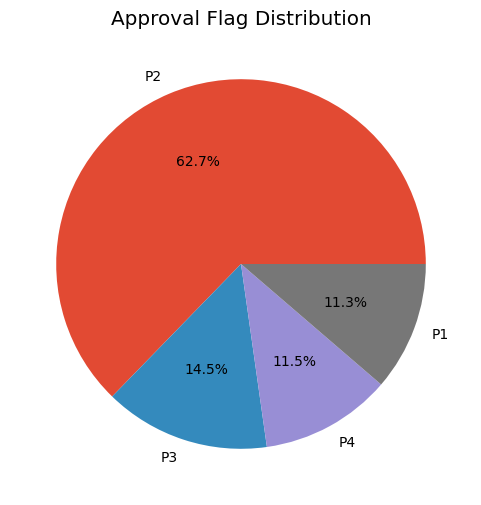
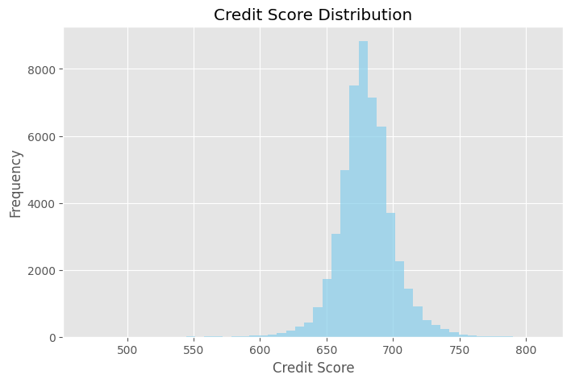
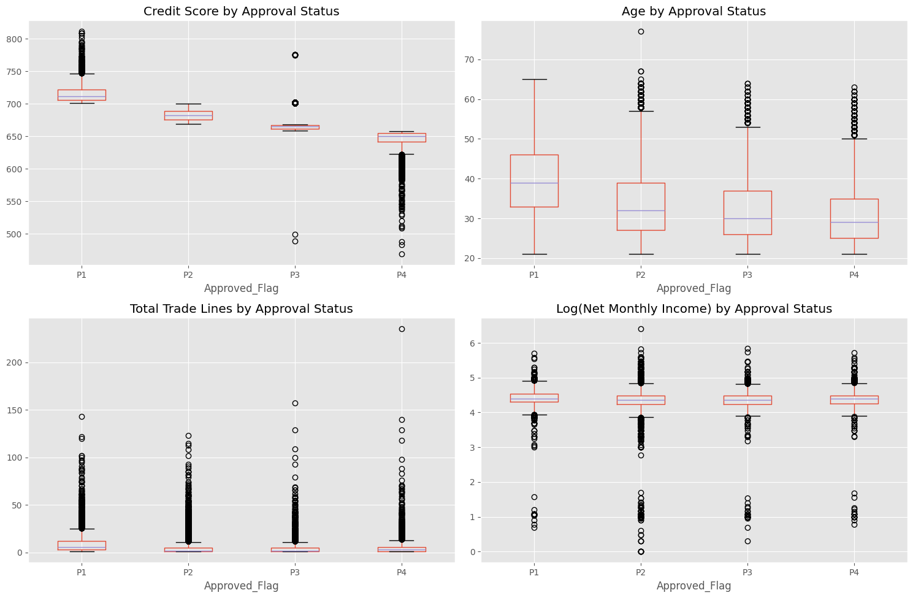
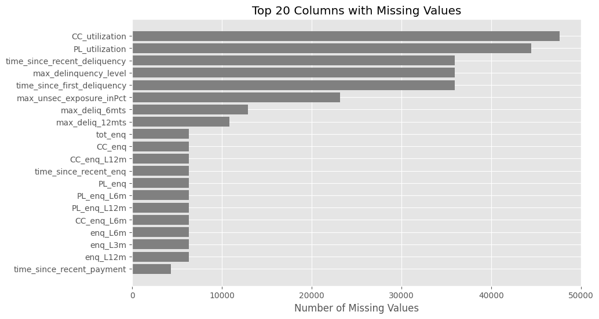
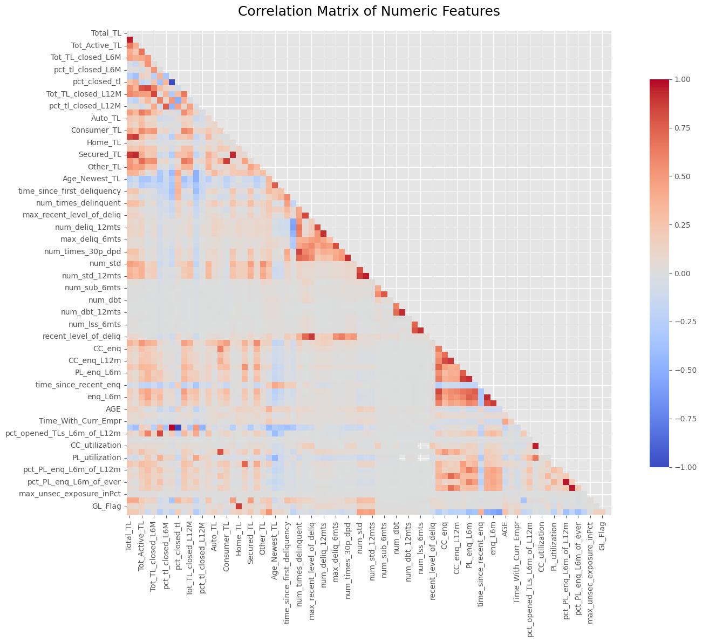
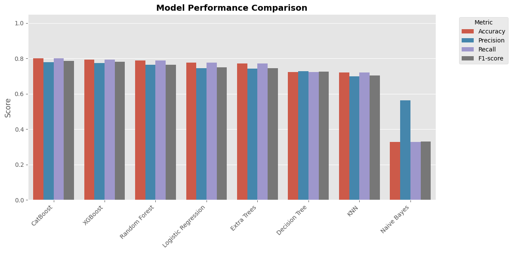
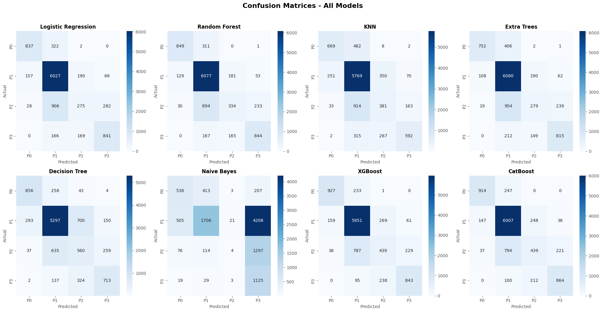

# 💳 Credit Risk Analysis and Loan Approval Prediction

---

## 📖 Overview

This repository contains a comprehensive Jupyter notebook ([CreditRiskEDA_LoanApproval.ipynb](https://colab.research.google.com/drive/1g_uLKLJcYQTYBa7wu4g3afXA7OqEvIyk?usp=sharing)) that demonstrates end-to-end credit risk modeling for loan approval, from exploratory analysis through feature selection, model comparison and ensembling.

All charts are also collected, in order, in the [visual artifacts gallery](images/README.md).

---

## 💾 Dataset Description

| Property | Value |
|---|---|
| **Records** | 51,336 loan applications |
| **Features** | 87 attributes including demographics, financial metrics, credit history, and trade line details |
| **Target** | `Approved_Flag` with four risk categories (P1–P4) |
| **Class imbalance** | P2 (62.7%), P3 (14.5%), P4 (11.5%), P1 (11.3%) (**Figure 1**) |

  

<em>Figure 1: Distribution of the <code>Approved_Flag</code> target. P2 alone accounts for almost two-thirds of applications, so accuracy would reward a model that simply predicts P2. This is why macro F1 and balanced accuracy are used later.</em>

---

## 🔍 1. Exploratory Data Analysis (EDA)

- Visualized class distribution and feature histograms (**Figure 2**)
- Identified demographic and credit-behavior patterns across risk categories (**Figure 3**)
- Audited missing values in credit-history and enquiry fields (**Figure 4**)
- Mapped correlations between numeric features to spot redundant groups (**Figure 5**)

  

<em>Figure 2: Credit score distribution. Scores are tightly concentrated between roughly 650 and 710, with a long thin tail toward 500, so small score differences carry a lot of signal.</em>

  

<em>Figure 3: Credit score, age, total trade lines and log(net monthly income) by approval category. Credit score separates P1 to P4 almost cleanly and age trends downward with risk, while income barely differs across classes.</em>

  

<em>Figure 4: Top 20 columns by missing-value count. Utilization and delinquency-history fields are missing for most applicants (often because the applicant has no such product or event), so missingness is treated as information rather than simply dropped.</em>

  

<em>Figure 5: Correlation matrix of numeric features. Trade-line counts, delinquency counts and enquiry counts each form strongly correlated blocks, which motivates the feature reduction in the next step.</em>

**Summary:** Credit score and age clearly stratify risk; product enquiry behavior differs by category.

---

## 🧬 2. Feature Selection & Engineering

- Applied ANOVA F-tests to rank 81 numeric features
- Selected top 20 features (e.g., `Credit_Score`, `enq_L3m`, `Age_Oldest_TL`)
- Encoded 19 categorical features via one-hot encoding

**Summary:** Reduced the feature set by 55% while preserving predictive power; 42 common features ensure deployment compatibility.

---

## 🧠 3. Model Development & Optimization

- Trained and compared 8 algorithms (Logistic Regression, Random Forest, XGBoost, CatBoost, etc.) (**Figure 6**)
- Addressed class imbalance with sample weights and SMOTE-Tomek
- Implemented ensemble methods: soft voting, weighted voting, stacking

  

<em>Figure 6: Accuracy, precision, recall and F1 for the eight base models. CatBoost and XGBoost lead at around 0.80 accuracy, the tree ensembles and logistic regression follow closely, and Naive Bayes trails far behind.</em>

---

## 🧮 4. Confusion Matrix Analysis

- Generated confusion matrices for all models (**Figure 7**)
- Evaluated class-wise performance for each risk category

  

<em>Figure 7: Confusion matrices for all eight base models (classes 0–3 correspond to P1–P4). Every model predicts the majority P2 class well, and the hardest class is P3, which is mostly misclassified as P2.</em>

**Summary:** CatBoost and XGBoost recover the most P1 and P4 applicants among the base models, and P3 is the weak spot for all of them. This motivates the imbalance handling and ensembles in the next step.

---

## 🏆 5. Advanced Model Optimization & Ensembles

| Model | F1 (Macro) | Balanced Accuracy |
|---|---|---|
| **XGBoost (Class Weights)** | 70.59% | **76.21%** |
| **Logistic Regression (SMOTE-Tomek)** | 67.22% | 72.81% |
| **Stacking Ensemble** | **70.69%** | 69.23% |
| **Hybrid Ensemble (Stacking + Weighted Voting)** | 70.06% | 68.54% |

**Conclusion:** The **stacking classifier** remains the optimal model, offering the best macro F1 for credit risk prediction. XGBoost with class weights is the strongest alternative when balanced accuracy matters most.

---

## 📄 License

This project is licensed under the MIT License - see the [LICENSE](LICENSE) file for details.
