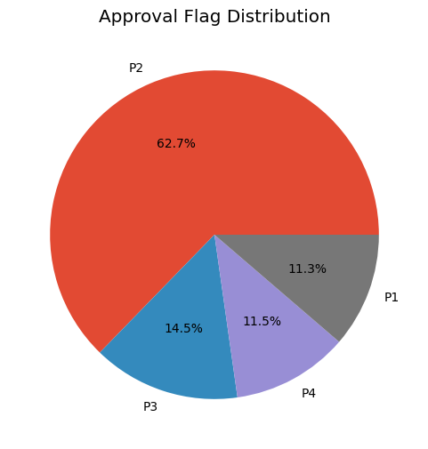
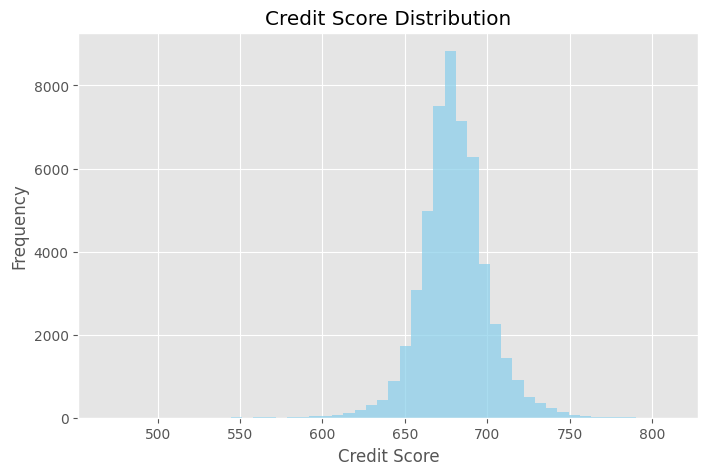
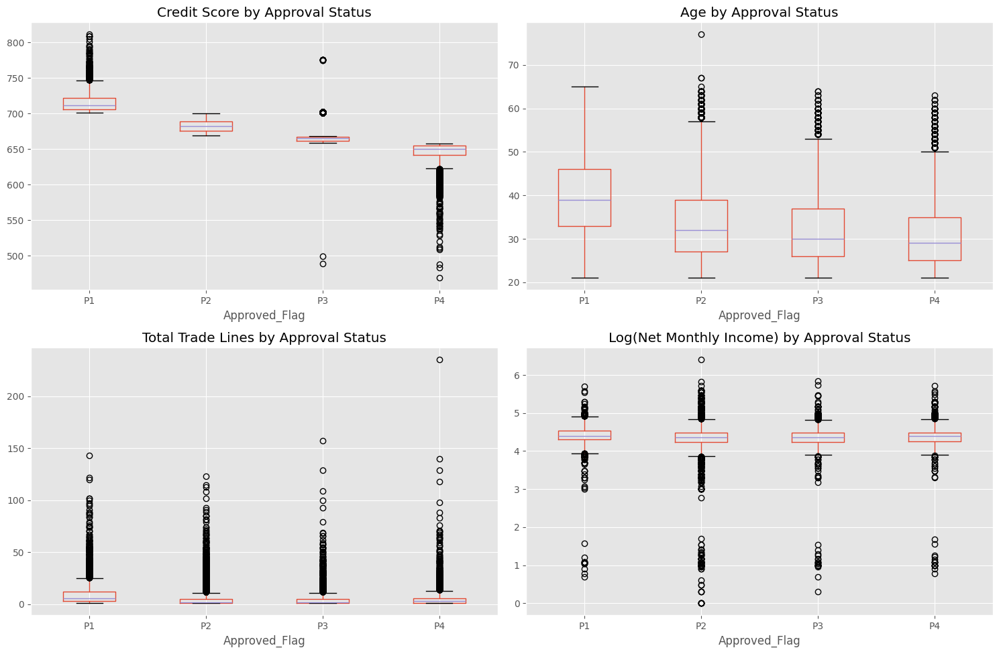
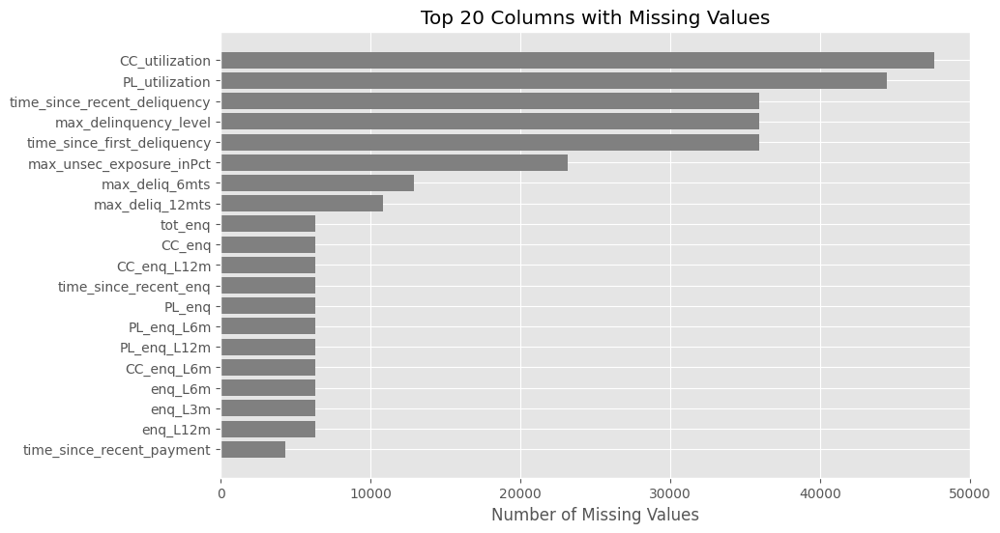
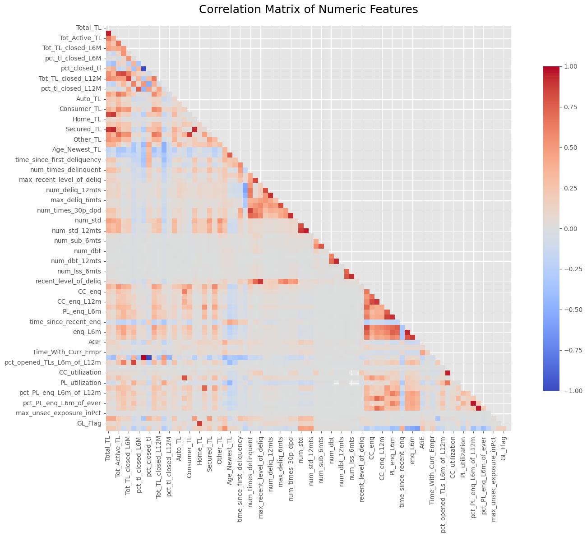
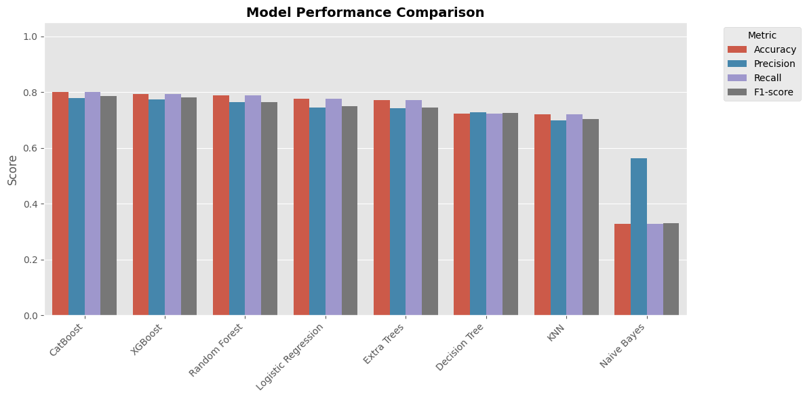
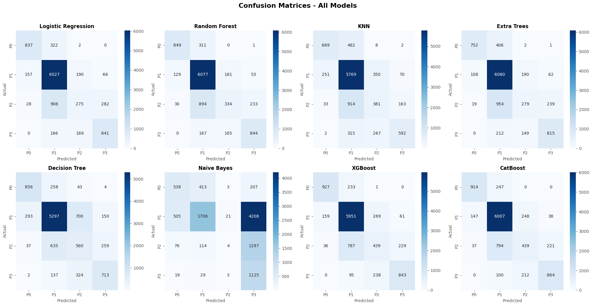

# 🖼️ Credit Risk Analysis - Visual Artifacts

This folder contains the key visualizations from the credit risk and loan approval workflow.
The figures are numbered in the same order as the [main README](../README.md): target distribution, exploratory analysis, then model evaluation.

| Figure | Chart | Stage |
|---|---|---|
| 1 | Approval flag distribution | Dataset |
| 2 | Credit score distribution | EDA |
| 3 | Feature box plots by approval status | EDA |
| 4 | Top 20 columns with missing values | EDA |
| 5 | Correlation heat map | EDA |
| 6 | Model performance comparison | Modeling |
| 7 | Confusion matrices, all models | Evaluation |

---

## 1. Approval Flag Distribution

  

<em>Figure 1: Distribution of the <code>Approved_Flag</code> target.</em>

**Insight:**
P2 accounts for 62.7% of applications, with P3, P4 and P1 each between 11% and 15%. Accuracy alone would reward predicting P2, so macro F1 and balanced accuracy are used for evaluation.

---

## 2. Credit Score Distribution

  

<em>Figure 2: Credit score distribution.</em>

**Insight:**
Scores are tightly concentrated between roughly 650 and 710, with a long thin tail toward 500, so small score differences carry a lot of signal.

---

## 3. Approval Status Box Plots

  

<em>Figure 3: Credit score, age, total trade lines and log(net monthly income) by approval category.</em>

**Insight:**
Credit score separates P1 to P4 almost cleanly and age trends downward with risk, while income barely differs across classes.

---

## 4. Top 20 Columns With Missing Values

  

<em>Figure 4: Top 20 columns by missing-value count.</em>

**Insight:**
Utilization and delinquency-history fields are missing for most applicants, often because the applicant has no such product or event. That makes missingness informative rather than noise.

---

## 5. Correlation Heat Map

  

<em>Figure 5: Correlation matrix of numeric features.</em>

**Insight:**
Trade-line counts, delinquency counts and enquiry counts each form strongly correlated blocks, which motivates reducing the feature set before modeling.

---

## 6. Model Performance Comparison

  

<em>Figure 6: Accuracy, precision, recall and F1 for the eight base models.</em>

**Insight:**
CatBoost and XGBoost lead at around 0.80 accuracy, the tree ensembles and logistic regression follow closely, and Naive Bayes trails far behind.

---

## 7. Confusion Matrices - All Models

  

<em>Figure 7: Confusion matrices for all eight base models (classes 0–3 correspond to P1–P4).</em>

**Insight:**
Every model predicts the majority P2 class well. The hardest class is P3, which is mostly misclassified as P2, and CatBoost and XGBoost recover the most P1 and P4 applicants.
